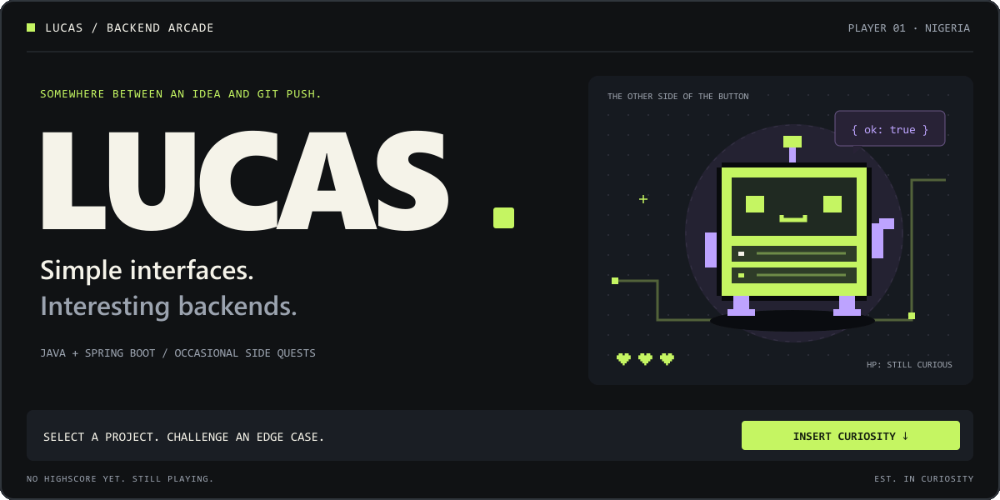
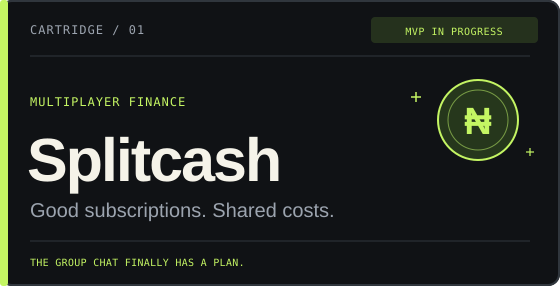
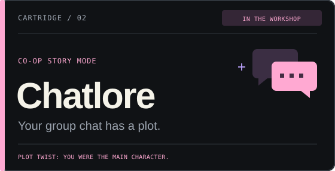
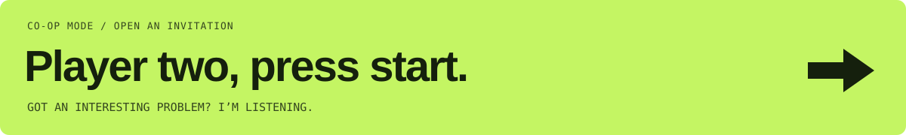

<a href="https://lucascodes.tech">
  <picture>
    <source media="(prefers-reduced-motion: reduce)" srcset="./assets/arcade-cover.svg" />
    
  </picture>
</a>

  <a href="#the-games">THE GAMES</a> &nbsp; / &nbsp;
  <a href="#boss-fights">BOSS FIGHTS</a> &nbsp; / &nbsp;
  <a href="#player-data">PLAYER DATA</a> &nbsp; / &nbsp;
  <a href="mailto:ayoolalucas.dev@gmail.com">PLAY CO-OP ↗</a>

 

I'm **Ayoola Oluwatobiloba Lucas** — a Java & Spring Boot developer studying Software Engineering at Babcock, Nigeria.

I build what happens **after you click the button**: the API, the authentication, the data, and the part where two people somehow book the last slot at the same time.

Welcome to my little corner of the internet. There are projects. There are side quests. There is probably an edge case I haven't thought of yet.

 

## The games

Things I'm building because the idea wouldn't leave me alone.

<table>
<tr>
<td width="50%" valign="top">

**One subscription. A whole crew.**

An invite-based platform for coordinating subscription costs. Nigeria-first MVP, private crews, simulated payments.

TYPESCRIPT · CLOUDFLARE WORKERS · POSTGRESQL

[Open the cartridge ↗](https://github.com/TobilobaLucas/Splitcash)

</td>
<td width="50%" valign="top">

**Your group chat has main characters.**

Turning WhatsApp exports into story-style recaps. Local chat analysis, AI-assisted storytelling, share cards. The lore was there all along.

CHAT ANALYSIS · AI STORYTELLING · SHARE CARDS

In the workshop. Someone has to document the chaos.

</td>
</tr>
</table>

**Bonus level unlocked:** built a video compression tool with quality controls, file-size limits, and automatic upload cleanup. My response to “file too large” was apparently to build software about it.

 

## Boss fights

The backend questions keeping me busy. **Pick a boss. Choose your move. See what breaks.**

<strong>01 · THE DOUBLE TAP</strong> — One click. Two requests. Two charges?

#### The encounter

A user taps Pay. The network stalls. They tap again. Both requests reach your API.

**Choose your move:**

A → Disable the Pay button immediately.

**NICE UX. THE BOSS IS STILL HERE.**

The browser isn't the only source of retries. The first request may already be in flight twice. The server needs a way to recognize the same operation.

Try move B.

B → Give the operation an idempotency key.

**BOSS WEAKNESS FOUND.** Store the key and operation result, enforce uniqueness in the database, and return the same result for a completed retry. Handle requests still in progress, and reject reuse of a key with a different payload. Pass an idempotency key to the payment provider too, where supported.

*The next question: what happens if the process crashes after the provider charges, but before you save the result?*

<strong>02 · THE LAST SLOT</strong> — Two people. One space. Unfortunate timing.

#### The encounter

Two requests both read “1 slot remaining.” Both try to claim it.

**Choose your move:**

A → Check the remaining slots again in Java.

**THE BOSS BROUGHT A SECOND THREAD.**

Both requests can pass the check before either writes. Checking more often doesn't make the check and the claim one operation.

Try move B.

B → Make the database claim the slot atomically.

**ONE SLOT. ONE WINNER.** For a counter, use a conditional update such as `UPDATE crews SET slots = slots - 1 WHERE id = ? AND slots > 0`, and check the affected row count. Keep the membership insert in the same transaction. Use database constraints for rules such as one membership per user per crew.

*The next question: which approach fits better when a “slot” is an actual seat with its own ID?*

<strong>03 · THE GHOST NOTIFICATION</strong> — The database saved it. The email never came.

#### The encounter

Your transaction commits. The process crashes before it sends the confirmation.

**Choose your move:**

A → Send the email immediately after the commit.

**THE GHOST LIVES BETWEEN THOSE TWO LINES.**

The process can still crash in that gap. Without a durable record of the pending email, a worker won't know there's anything to retry.

Try move B.

B → Save an outbox event in the same transaction.

**THE GHOST LEFT A PAPER TRAIL.** Save the business change and an outbox event in one database transaction. A worker delivers the event and retries failures. Delivery can happen more than once, so consumers need deduplication; external services may need their own idempotency support.

*The next question: how do you spot an event that keeps failing without quietly forgetting it?*

Currently studying these patterns, their tradeoffs, and what happens when the obvious fix meets an inconvenient crash.

 

## Player data

| Slot | Equipped |
| :--- | :--- |
| **Main loadout** | Java 21 · Spring Boot · Spring Security · REST · JWT |
| **Inventory** | PostgreSQL · Redis · JPA · JDBC |
| **Secondary** | TypeScript · React · Next.js · Cloudflare Workers |
| **Current side quests** | Rust · concurrency · failure recovery · systems programming |
| **Design preference** | A quiet interface with a lot going on underneath |
| **Known weakness** | “This could be a small side project.” |

Inspect the player →

I like projects with a little personality. Useful doesn't have to mean boring.

Right now I'm getting deeper into what happens when requests overlap, dependencies fail, and a happy-path demo meets actual users. Java and Spring Boot are my focus; TypeScript helps me take an idea all the way to the screen.

If you're building something thoughtful, strange, useful, or some combination of the three, we might get along.

 

  <a href="https://lucascodes.tech"><strong>Portfolio ↗</strong></a> &nbsp; · &nbsp;
  <a href="mailto:ayoolalucas.dev@gmail.com">Email</a> &nbsp; · &nbsp;
  <a href="https://www.linkedin.com/in/ayoola-lucas-595063379">LinkedIn</a> &nbsp; · &nbsp;
  <a href="https://x.com/AyoolaLucas">X</a>

No high score yet. Still playing.

